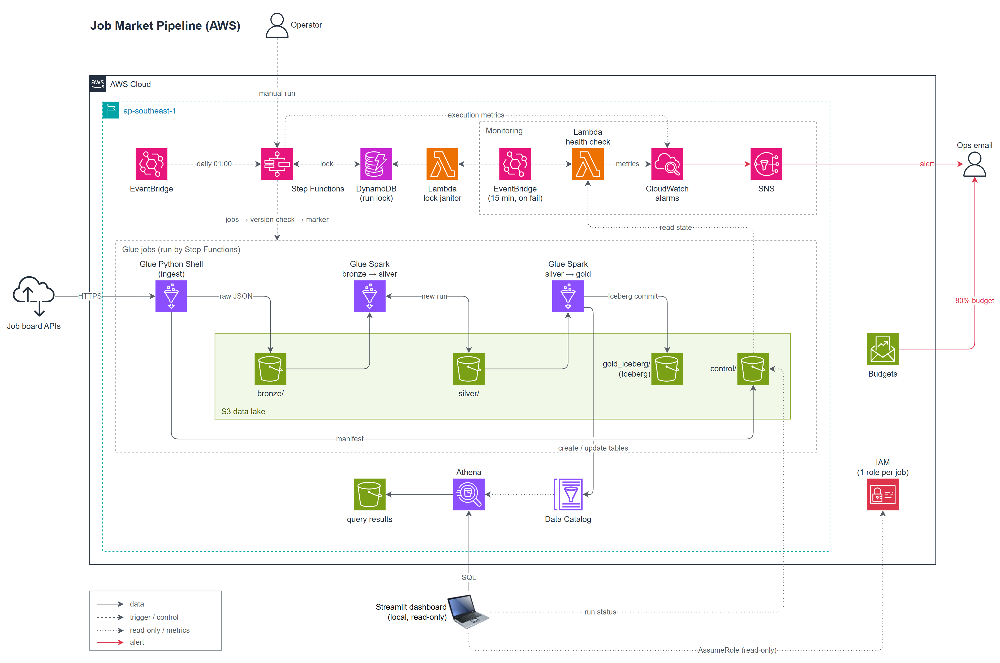
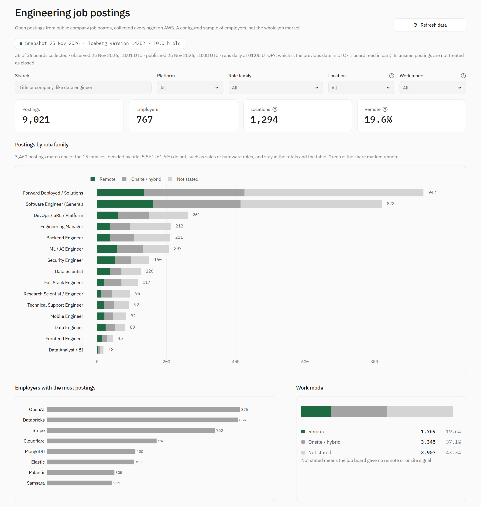
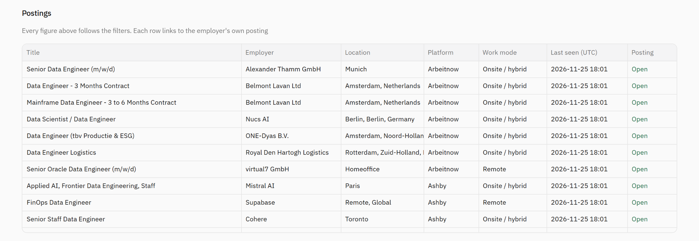

# Job Market AWS Pipeline

[](https://github.com/Viluoicode/Job-Market-Pipeline-cloud/actions/workflows/tests.yml)
[](https://github.com/Viluoicode/Job-Market-Pipeline-cloud/actions/workflows/terraform.yml)
[](LICENSE)

**A serverless AWS data pipeline that collects public job postings every night, tracks each
posting from first sighting to closure, gates every run on data quality, and publishes
Athena-ready analytics tables. All infrastructure is Terraform, and it runs without a laptop.**

It reads 36 company job boards through four public APIs (Greenhouse, Lever, Ashby, Arbeitnow),
lands raw JSON in an S3 medallion lake, reconciles each posting's lifecycle with Spark, and serves
the result through Athena to a read-only Streamlit dashboard.

> Dự án thực hành Data Engineering trên AWS. Hướng dẫn thực hành song ngữ: [docs/workshop.md](docs/workshop.md).

## At a glance

| Area | Result |
| --- | --- |
| Reliability | 68 of 68 scheduled nightly runs succeeded, 15 Sep – 21 Nov 2026 (UTC) |
| Latest snapshot | 8,672 open postings from 467 employers; 36 of 36 boards collected (21 Nov 2026) |
| Run time | 7 minutes from trigger to published tables with Iceberg Gold (25 Nov); 9 minutes before (median, 14–20 Nov) |
| Cost | About $0.06 per run in AWS Glue before credits, down from $0.11 once the crawler was removed; orchestration and monitoring stay in the free tier |
| Quality gates | 260+ tests, ruff, Terraform validation and a Checkov scan on every pull request; 60/60 IAM permission simulations |

## Architecture



1. **EventBridge** starts a **Step Functions** workflow at 01:00 UTC+7. The workflow holds a
   **DynamoDB** writer lock for the whole run.
2. A **Glue Python Shell** job calls the job-board APIs, five at a time, writes raw JSON to
   `bronze/` and then commits a run manifest. Later stages read only the objects it lists.
3. A **Glue Spark** job builds Silver: it reconciles each posting's lifecycle and stops the run if
   **Glue Data Quality** rules fail. A second Spark job commits three Gold marts as **Apache
   Iceberg** tables, one atomic commit per table.
4. The workflow checks the Gold job's version record, then publishes a completion marker that names
   each table's Iceberg snapshot. **Athena** serves exactly those versions.
5. A **Lambda** health monitor checks freshness every 15 minutes and alarms through **SNS**. A
   lock-janitor Lambda frees a lock left behind by an aborted run.

More: [architecture and invariants](docs/architecture.md) ·
[editable diagram](docs/diagrams/architecture.drawio) ·
[permission matrix](docs/security-review.md)

## Key engineering decisions

- **The manifest is the commit point.** Ingestion writes every board's file first and the manifest
  last, and Silver reads only what the manifest lists. A crash leaves unread files, never a
  half-visible run. A run that collects zero rows fails instead of publishing an empty market.
- **Lifecycle reconciliation instead of daily dumps.** A posting closes when a board that answered
  completely stops listing it. Postings from a failed or truncated board keep their last
  observation and expire only after seven days unseen, so a source outage never looks like a wave
  of closures.
- **One writer, released by evidence.** A conditional DynamoDB lock serializes the workflow, with
  no TTL that could expire mid-write. A lock-janitor Lambda releases an orphaned lock only after the
  owning execution has ended and no Glue job is still running.
- **Publish only what was verified.** Data-quality rules gate Silver. The completion marker is
  written only from a Gold version record that matches this run. The dashboard checks the lock and
  the marker before and after it reads, and refuses stale or in-progress data.
- **Atomic, pinned Gold with Apache Iceberg.** Each table replaces its day in one commit, and the
  completion marker pins the three snapshot ids, so readers query one consistent set with
  `FOR VERSION AS OF`. The migration ran in shadow mode first and was compared with the old
  Parquet Gold row by row; it also removed the crawler, about 44% of Glue cost per run.
- **Least privilege, checked in CI.** Each stage runs under its own IAM role and the dashboard
  assumes a read-only role. Checkov runs on every pull request with zero open findings; each
  accepted one carries a written reason next to the resource.

## Results

The dashboard reading the published snapshot of 21 November 2026 (UTC):





### Performance and cost

Measured by `scripts/run_metrics.py`. **Before:** the 7 scheduled runs of 14–20 November 2026,
medians, Parquet Gold with a crawler ([evidence](docs/evidence/run-metrics-20261121.json)).
**After:** the first run with parallel fetching and Iceberg Gold, 25 November 2026
([evidence](docs/evidence/run-metrics-20261125-iceberg.json)). One run is an early reading, not a
median; Silver did not change, so its time is the control.

| Metric | Before | After |
| --- | --- | --- |
| End-to-end (trigger → published Gold) | 9m 00s | 6m 52s |
| Ingest | 1m 59s | 0m 56s (five boards fetched at a time) |
| Bronze→Silver | 2m 58s | 3m 04s (unchanged job) |
| Silver→Gold | 3m 00s | 2m 50s (Iceberg commits plus version record) |
| Crawl | 1m 01s | none: the Gold job registers its tables |
| Glue DPU-seconds per run (jobs) | 517 | 485 |
| Glue cost per run: jobs | $0.064 | $0.059 (estimate at $0.44/DPU-hour, AWS Pricing API) |
| Glue cost per run: crawler | $0.049 (Cost Explorer) | $0 |
| Glue cost per run: total | about $0.11 | about $0.06 |
| Rows: Bronze → Silver lifecycle → Gold | 8,099 → 43,540 → 8,505 | 8,421 → 46,115 → 8,502 |
| Dashboard query scan | 1.0 MiB | 0.6 MiB (one pinned Iceberg snapshot) |

Costs are pre-credit list prices. Lambda, Step Functions, EventBridge and the six alarms stayed in
the free tier; S3 and DynamoDB added cents per day. Gold can exceed one run's Bronze rows: postings
from a failed or incomplete board keep their last observation while still inside the freshness
window ([why](docs/sample_results.md), [lifecycle](docs/architecture.md)).

## Tech stack

AWS (S3, Glue Python Shell and Spark, Glue Data Quality, Step Functions, EventBridge, DynamoDB,
Athena, Lambda, CloudWatch, SNS, IAM, Budgets) · Terraform · Python · PySpark · Apache Iceberg ·
Streamlit · pytest · ruff · Checkov · GitHub Actions

## Repository layout

```text
ingestion/    Public API connectors, source catalog and run manifest
glue/jobs/    Silver lifecycle (Parquet), data quality and Gold marts (Apache Iceberg)
infra/        Terraform: storage, jobs, orchestration, IAM, monitoring, cost controls
monitoring/   Health monitor and lock janitor Lambdas
dashboard/    Athena reader, publication checks and Streamlit page
scripts/      Freshness, permission, run-metrics and Iceberg parity checks
sql/          Athena inspection and analysis queries
tests/        Spark, ingestion, contract, dashboard, Lambda and Iceberg tests
docs/         Architecture, runbooks, lab guide, costs and dated evidence
```

## Run and develop

The stack is deployed and runs on its own; viewing results needs no deploy.

- Open the dashboard: [operations.md → Open the dashboard](docs/operations.md#open-the-dashboard--mở-dashboard)
- Deploy a copy, daily checks, recovery, pause and cleanup: [operations.md](docs/operations.md)
- Guided lab in Vietnamese and English: [workshop.md](docs/workshop.md)
- Every document and what it covers: [documentation map](docs/README.md)

Local checks use Python 3.11, plus Java 17 for the Spark tests:

```powershell
python -m pip install -r requirements-dev.txt
python -m ruff check .
python -m pytest tests -q
terraform -chdir=infra init -backend=false
terraform -chdir=infra fmt -check -recursive
terraform -chdir=infra validate
```

Tests mock the source APIs and AWS clients; dated AWS evidence lives in [docs/evidence](docs/evidence/README.md).

## Limits

- A fixed sample of 36 public boards from large employers plus one aggregator. It is not the whole
  job market and not specific to Vietnam.
- Role families come from job-title rules, one family per posting. Work mode depends on what each
  source states, and about 45% of postings state none; those are reported as "not stated".
- Arbeitnow is read two pages deep and flagged as incomplete.
- The three Gold tables commit separately; readers stay consistent through the pinned snapshot
  ids rather than one multi-table transaction.
- Glue and supporting services cost money even when credits cover them, and budget alerts do not
  cap spending. Read [cost and security](docs/cost-and-security.md) and
  [cleanup](docs/operations.md#cleanup--kết-thúc-lab) before deploying or retiring a copy.

## License

[MIT](LICENSE).
