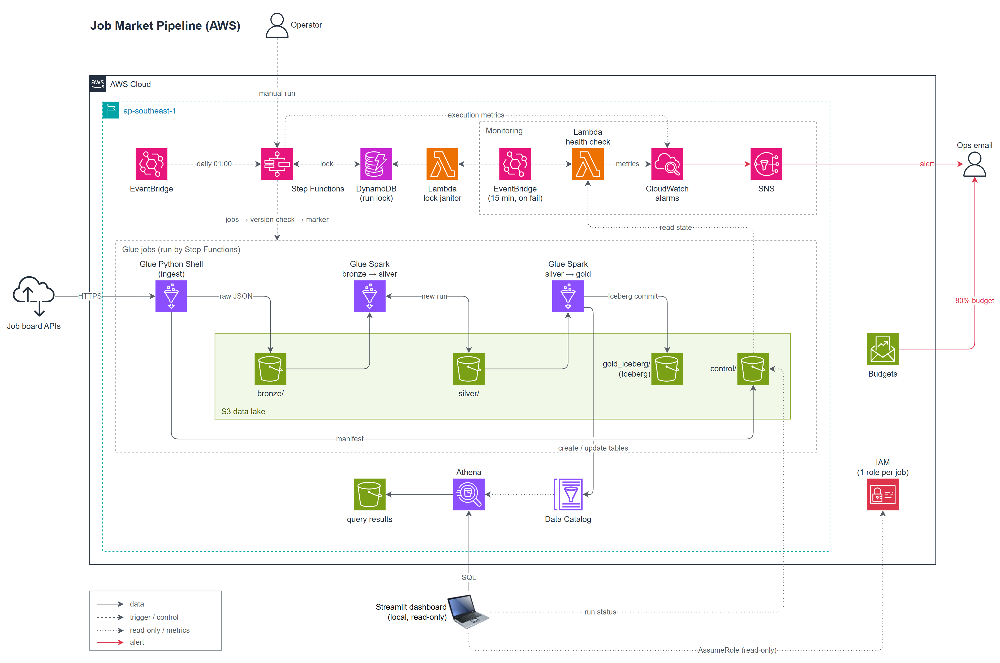
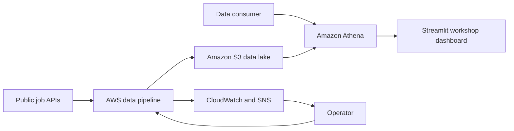
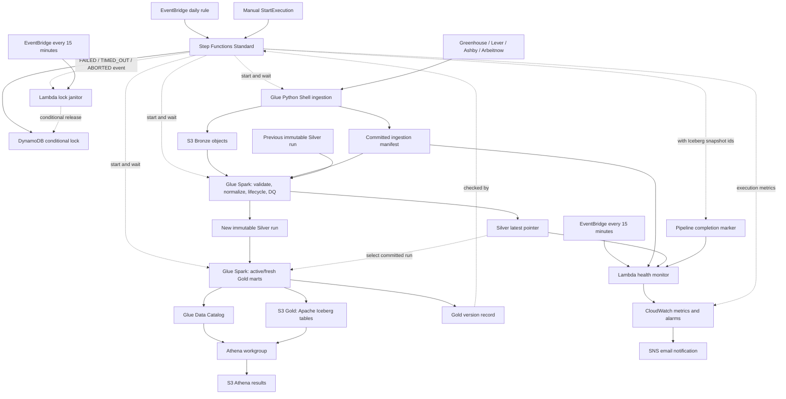

# System architecture



[Editable diagram](diagrams/architecture.drawio) (draw.io). The text diagram under
[Container and data flow](#container-and-data-flow) shows the same paths.

This document describes the current design and its invariants. Deployment commands and incident
procedures belong in [operations.md](operations.md); monitoring thresholds and alarm response
belong in [monitoring.md](monitoring.md).

## Goals and boundaries

The system collects a configured sample of public job boards, turns source-specific payloads into
traceable lifecycle records, and publishes fresh analytical marts. It is designed for one daily
writer, low operational overhead, and serverless query access.

The source catalog is not the entire job market. Role families are title-based classifications,
and remote status reflects source metadata. The system serves data through Athena and a local Streamlit workshop dashboard. The dashboard
checks publication metadata and the writer lock before and after reading the published partition.

## System context



## Container and data flow



Solid arrows primarily show data/metadata movement; dashed arrows label control or metric paths.
Step Functions conditionally releases its DynamoDB lock after publication or caught failure;
after an abort/timeout the lock janitor releases it once the pipeline's Glue jobs are idle
([runbook](operations.md)).

The state machine is the only authorized production write path. A run identifier and the UTC date
of the execution are fixed at workflow start and passed to every stage.

## Component responsibilities

| Component | Single responsibility |
| --- | --- |
| EventBridge pipeline rule | Start one scheduled state-machine execution each day |
| Step Functions | Coordinate the run, handle failures, and publish completion only after success |
| DynamoDB lock | Serialize writers across the entire workflow |
| Glue Python Shell | Fetch and canonicalize source records and commit the run manifest |
| S3 lake | Store Bronze, Silver, Gold, quality, and control/state objects |
| Glue Bronze-to-Silver | Validate the run, reconcile lifecycle, and enforce data quality |
| Glue Silver-to-Gold | Build the marts and commit them to Iceberg, one atomic commit per table |
| Glue Data Catalog | Hold the Iceberg tables the Gold job creates and updates (no crawler) |
| Athena | Provide serverless SQL access with a per-query scan limit |
| Lambda health monitor | Independently evaluate publication freshness and source coverage |
| Lambda lock janitor | Release an orphaned writer lock only after its execution and all Glue work ended |
| CloudWatch and SNS | Detect execution/health failures and notify an operator |
| Terraform | Define infrastructure, policies, schedules, uploads, and cost controls |

## Run contract

Every production execution has one immutable `run_id`. Ingestion writes one canonical newline-
delimited JSON object for each successful board and commits the manifest only after those objects
exist.

```text
bronze/run_id=<run>/source=<source>/board=<token>/jobs.json
control/ingestion/run_id=<run>/manifest.json
silver/runs/<run>/jobs/*.parquet
quality/silver_jobs/<run>/
state/silver/latest.json
gold_iceberg/<mart>/data/snapshot_date=<utc-date>/*.parquet
gold_iceberg/<mart>/metadata/
state/gold_iceberg/run_id=<run>.json
state/pipeline/latest.json
```

The manifest distinguishes four operational facts:

- a successful board with records;
- a successful empty board;
- a failed board;
- a successful but incomplete board, such as capped pagination.

At least 80% of configured boards and at least one posting are required by default. Silver reads
only objects named by the committed manifest and rejects stale, mismatched, malformed, or
uncommitted input. It never scans accumulated Bronze and relabels old observations as current.

## Posting identity and lifecycle

`job_id` is the lowercase SHA-256 of `source|board_token|source_job_id`. Including the board avoids
collisions when different employers reuse an internal source ID. `dedup_hash` is derived from
normalized company, title, and location and is used for cross-source content deduplication in
Gold. Among copies with the same `dedup_hash`, Gold keeps the most recently observed one
(`last_seen_at`), then the one reporting `posted_at`, then the lowest `job_id` for determinism.

| Observation | Silver state | Gold eligibility |
| --- | --- | --- |
| Seen in the current run | Preserve `first_seen_at`, update `last_seen_at`, active | Included while fresh |
| Missing from a successful complete board | Inactive: `absent_from_complete_board` | Excluded |
| Board failed, was removed, or was incomplete | Preserve last observation: `board_unverified` | Included only inside the freshness window |
| Not observed for seven days | Inactive: `stale_observation` | Excluded |
| Previously inactive posting returns | Reactivate and preserve original first-seen time | Included while fresh |

Failed and incomplete boards never advance `last_seen_at` and do not immediately close earlier
postings. A successful empty board can close its earlier postings because the empty result is a
complete observation.

## Commit and publication model

Silver writes an immutable run, persists the data-quality result, and then advances
`state/silver/latest.json`. Gold reads that exact committed run and replaces only the requested
UTC `snapshot_date` partition, including when output is empty.

Gold is five Apache Iceberg tables in the `<gold database>_iceberg` Glue database, with data and
metadata under `s3://<lake>/gold_iceberg/`. Each table commit is atomic and replaces exactly one
`snapshot_date`, also when the mart is empty, so a reader sees the previous or the new version,
never a half-written day. The Gold job creates and updates the tables itself; their schema comes
from code, and there is no crawler.

Iceberg is atomic per table, not across the five marts. So after its five commits the Gold job
writes `state/gold_iceberg/run_id=<run>.json` with each table's new snapshot id (as text: ids
exceed 2^53). Step Functions checks that this record belongs to the run, then copies the ids into
`state/pipeline/latest.json`. Readers query `FOR VERSION AS OF <snapshot id>`, so they read one
consistent set even if a later run commits meanwhile. Consumers must still validate matching
Silver and pipeline run IDs plus wall-clock freshness before treating a snapshot as current.

Old snapshots are expired by the Gold job after each publish, under the same writer lock: those
older than 30 days go, but never one at or after the snapshot the completion marker pins, so a
reader's pinned version always exists. Without this, every overwritten day would keep its files
forever.

History: until November 2026 Gold was plain Parquet under `gold/`, registered by a crawler. Iceberg
ran in shadow mode for several days, compared with Parquet by `scripts/compare_iceberg.py`
([evidence](evidence/README.md)), before readers switched and the crawler was removed. The Parquet
files and their `jobmarket_aws_gold` tables are kept as read-only history.

The date boundary is UTC. For example, a run at 01:00 on 17 September in UTC+7 starts at 18:00 on
16 September UTC and therefore publishes `snapshot_date=2026-09-16`.

## Gold data products

| Mart | Grain | Use |
| --- | --- | --- |
| `fact_job_posting` | One active, fresh, content-unique posting | Inspect jobs, employers, locations, remote state, and application URLs |
| `demand_by_role` | One configured role family per snapshot | Compare distinct posting demand |
| `role_opportunity` | One configured role family per snapshot | Rank demand and expose remote share and top employer |
| `job_detail` | One `fact_job_posting` row | Description, dictionary-matched skills and the salary the source published, for search and CV matching |
| `skill_demand` | One role family (or all postings) and skill per snapshot | Rank skills by postings, with company count and share |

Each posting belongs to at most one title-based role family (first match by priority; see
[data-dictionary.md](data-dictionary.md#role-families--nhóm-role)), so role counts add up. These marts describe the configured
source sample and must not be presented as the whole labor market.

## Reliability and failure containment

- A conditional DynamoDB lock prevents overlapping writers.
- Each Glue job also has a concurrency limit.
- Network errors, HTTP 429, and transient 5xx responses are retried with backoff.
- Up to five board APIs are called concurrently; Bronze writes and the manifest stay sequential in
  configured board order. At most ten boards are fetched ahead of the writer, which bounds memory
  in the ~1 GB Python Shell, and a storage error still aborts the run.
- A committed ingestion run can be read again without changing its observation time.
- Silver state advances only after validation, data quality, and Parquet output succeed.
- Completion is published only from a Gold version record that matches the run and names all
  five tables.
- The workflow has a 90-minute ceiling; Glue stages have independent timeouts.
- Aborted or timed-out external jobs must be confirmed stopped before an orphaned lock is removed;
  the lock janitor automates this check and releases the lock conditionally on its owner.
- The monitor is independent of the pipeline and treats a missing health signal as a failure.

## Security boundaries

- Lake, script, and Athena-result buckets are private and encrypted at rest.
- AWS services assume runtime IAM roles; no application access key is stored in the repository.
- Ingestion, transformation, orchestration, schedule, and monitoring permissions are separated by
  role or responsibility.
- The health monitor can read control metadata, write its own logs, and publish project metrics;
  it cannot mutate the lake or start a pipeline execution.
- The lock janitor can read execution and job-run status and delete only the pipeline lock
  key; it cannot start or stop executions or Glue jobs.
- Athena uses an enforced workgroup result location and a 10 GiB scan cutoff.

Security controls are defined mainly in `infra/s3.tf`, `infra/iam.tf`, `infra/ingestion.tf`,
`infra/schedule.tf`, `infra/monitoring.tf`, `infra/lock_janitor.tf`, and `infra/athena.tf`.

Silver and Gold use separate custom IAM roles. Runtime roles cannot modify scripts;
Step Functions alone among pipeline runtime roles writes the completion marker. The dashboard
assumes a dedicated reader role for every AWS data-access session. All three buckets enforce HTTPS
for non-service principals. Ownership and lake/scripts versioning are managed by Terraform.
See [security-review.md](security-review.md) for the exact read/write matrix and remaining boundaries.

## Storage lifecycle

| Data | Default retention | Reason |
| --- | --- | --- |
| Bronze and ingestion manifests | 30 days | Support replay/audit while bounding raw storage |
| Quality results | 90 days | Retain operational evidence longer than raw payloads |
| Athena results | 7 days | Query output is reproducible |
| Glue temporary data | 7 days | Remove abandoned transient data |
| Silver, Gold, and state | No automatic expiration | Preserve lifecycle and historical analytical state |
| Overwritten or deleted object versions (lake, scripts) | 30 days | Recover a bad overwrite, then stop paying for it |
| Incomplete multipart uploads | 7 days | Abandoned upload parts are billed but invisible |
| Glue and Lambda logs | 30 days (Glue), 14 days (Lambda) | Debug recent runs; evidence lives in S3 |

Current-object expiration on the versioned lake/scripts buckets creates a noncurrent version; that
version, and any overwritten one, is deleted 30 days later (`noncurrent_version_retention_days`,
agreed 22 November 2026), and orphaned delete markers are removed. Nonempty bucket destruction is
opt-in via allow_bucket_force_destroy.

## Design decisions and trade-offs

- **S3 instead of an always-on database:** durable, inexpensive storage fits daily batch volume;
  Athena supplies query access without a cluster.
- **Glue Python Shell for ingestion:** API collection is lightweight and does not justify Spark.
- **Glue Spark for lifecycle transforms:** the implementation uses DataFrame operations, Parquet,
  and Glue Data Quality while remaining managed.
- **Step Functions instead of a scheduler-only chain:** the workflow needs ownership, waits,
  retries, publication checks, and failure cleanup across AWS services.
- **DynamoDB lock instead of a time-based lock:** a TTL could expire while an external Glue task
  still writes, allowing corruption through concurrent runs. The lock janitor releases by
  evidence (owner ended, Glue jobs idle), not by elapsed time.
- **Daily schedule:** it balances freshness with Glue cost for this portfolio-scale source set.
- **Athena instead of Redshift:** current SQL volume does not justify a dedicated warehouse.
- **Step Functions instead of MWAA:** this AWS batch workflow does not currently justify
  operating an Airflow environment.
- **Apache Iceberg for Gold, introduced behind a shadow phase:** atomic per-table commits and
  pinned versions replace partition overwrites and a crawler. Because the format changes how every
  reader sees Gold, both formats first ran side by side and were compared row by row.
- **Separate health monitor:** successful orchestration alone does not prove fresh, internally
  consistent, or sufficiently covered data.

## Infrastructure map

| Concern | Terraform definition |
| --- | --- |
| Storage, encryption, and lifecycle | `infra/s3.tf` |
| Ingestion job, source catalog, and lock | `infra/ingestion.tf` |
| Spark jobs and Gold databases | `infra/glue.tf` |
| Script uploads and shared contract | `infra/scripts_upload.tf` |
| Orchestration and completion marker | `infra/stepfunctions.tf` |
| Runtime permissions | `infra/iam.tf`, `infra/iam_runtime.tf`, `infra/ingestion.tf`, `infra/schedule.tf`, `infra/monitoring.tf`, `infra/lock_janitor.tf` |
| Daily schedule | `infra/schedule.tf` |
| Monitoring and notification | `infra/monitoring.tf` |
| Orphaned-lock recovery | `infra/lock_janitor.tf` |
| Athena and saved queries | `infra/athena.tf` |
| Budget guardrail | `infra/budget.tf` |

## Known limitations

- Arbeitnow pagination is capped at two pages and is marked incomplete when more pages exist.
- The five Gold tables commit separately; readers get a consistent set through the snapshot ids
  in the completion marker, not through one multi-table transaction.
- Role classification uses title rules rather than a trained semantic classifier.
- Skills come from a fixed dictionary of 83 names; an employer's standard text can inflate a skill,
  which `skill_demand.company_count` exposes. Salary exists for about 42% of postings, in the
  published currency, and its period is often not stated.
- Remote status depends on source metadata quality.
- Lifecycle history from the current method begins with the September 2026 migration; earlier
  Gold snapshots used a different accumulated-Bronze method and are not trend-comparable.

See [sample_results.md](sample_results.md) for point-in-time analytical results and their
interpretation limits.

## Dashboard serving boundary

`dashboard/data_access.py` checks the DynamoDB writer lock, matching Silver/completion/manifest
identities, snapshot dates and ingestion age (maximum 26 hours). It reads only the published fact
version (`FOR VERSION AS OF` the snapshot id in the completion marker), then checks again. Cached results include S3 metadata fingerprints in their key.
An in-progress, stale, failed or changed publication blocks display; no fallback to MAX(date).
This is a conservative reader safeguard; the pinned version keeps the read itself consistent. A run may begin
after a page is rendered; the page is a point-in-time view and idle pages do not auto-refresh.

The UI runs on the presenter's laptop and reads AWS; it is not publicly hosted. Stopping the UI
does not stop AWS ingestion. The dashboard has no ingestion controls and does not write the lake;
Athena stores query results in its workgroup result bucket. All charts derive from the same fact
rows so filters stay consistent. Role patterns are checked against Gold in regression tests.
